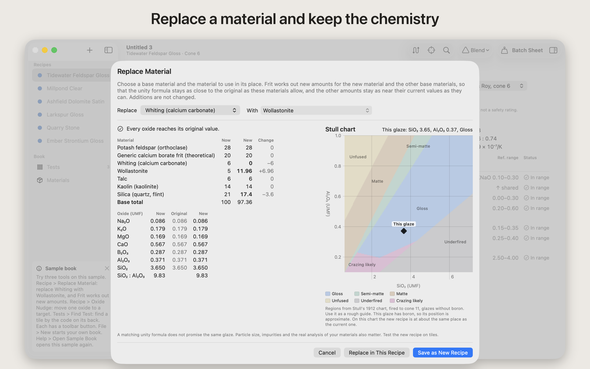
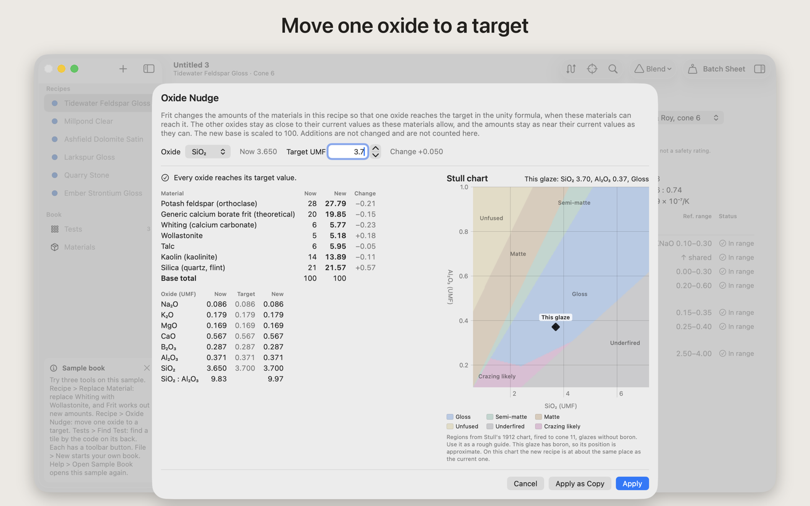

# Frit

Frit is a glaze recipe book for potters on the Mac. It reworks a glaze recipe when a material changes, moves one oxide to a target, and finds each fired test tile by the code on its back. It works offline, and your recipes stay in your own files.

- Download the notarized app: https://github.com/theluckystrike/frit/releases/latest or https://frit-app.pages.dev/



## What Frit does

- **Replace Material.** Choose a material that changed or ran out, and the one to use in its place. Frit works out new amounts so that the unity formula stays as close to the original as the materials allow. The sample swaps Whiting for Wollastonite, and every oxide reaches its original value.
- **Oxide Nudge.** Move one oxide (for example SiO2) to a target value. Frit changes the base materials and shows the new recipe before you save it as a copy.
- **Test tiles.** Give each fired test a code. Write the code on the back of the tile. Find the test later by its code, and print labels.
- **Stull chart.** See where the glaze sits on the SiO2 and Al2O3 chart (a rough guide).
- **Offline.** No account. Your recipes stay in your own files.



A matching unity formula does not promise the same glaze. Particle size, impurities and the real analysis of your materials also matter. Test each new recipe on tiles.

The code is under the MIT License. See [LICENSE](LICENSE).

## Build

You need Xcode 16 or later on macOS 14 or later.

```sh
swift build
swift test
```

To build the Mac app bundle, open `Frit.xcodeproj` in Xcode. To build it from the terminal, run `tools/xcode_archive.sh`. Set `FRIT_TEAM_ID` to your own Apple team ID.

## Layout

- `Sources/GlazeCore`: recipe math (unity formula, oxide targets, material swaps, test tiles).
- `Sources/GlazeApp`: the AppKit and SwiftUI app.
- `Tests`: unit tests for the core and the app.
- `tools`: build, packaging and check scripts.

## Contact

Open an issue in this repository. Email: support@barframe.com.

## Support this work

Frit is free and open source. If it saves you time at the wheel or the kiln, you can support its work:

- [GitHub Sponsors](https://github.com/sponsors/theluckystrike)
- [PayPal](https://paypal.me/najzzz)
- [Buy Me a Coffee](https://buymeacoffee.com/michaellip)

A star on this repository also helps other people find it.
